# Secure Task Manager — API segura con Node.js + cliente Flutter

Actividad **9. Guiado API Segura**. Implementación completa del tutorial
*Full-Stack Tutorial: Secure Node.js API with a Flutter Client*: API REST versionada
(Express + PostgreSQL + Prisma) con autenticación JWT, rotación de refresh tokens con
detección de reutilización, y una app Flutter que la consume con Riverpod.

> Proyecto de aprendizaje, no una auditoría de seguridad para producción.

## Estructura

```
backend/                 API REST (Node.js, Express 5, Prisma 6, PostgreSQL 16)
  compose.yaml           PostgreSQL en Docker
  prisma/                Esquema y migraciones (User, Task, RefreshToken)
  src/
    routes/              URL -> validación -> controlador
    controllers/         Lectura de request / respuesta
    services/            Reglas de negocio (auth, tareas)
    repositories/        Acceso a datos, siempre filtrado por dueño
    middleware/          requireAuth, validate (Zod), errorHandler
    schemas/             Esquemas Zod
    utils/               Tokens (JWT, refresh opaco, SHA-256)
  tests/                 Jest + Supertest (25 pruebas)
  scripts/token-flow.sh  Ejercicio 19a automatizado
  docs/openapi.yaml      Contrato OpenAPI 3.0.3
mobile/                  App Flutter
  lib/core/              config, cliente HTTP, almacenamiento seguro, providers
  lib/features/auth/     repositorio, controlador de sesión, login/registro
  lib/features/tasks/    modelo, repositorio, controlador, pantallas
  test/                  Pruebas unitarias y de widgets (16 pruebas)
  test_e2e/              Prueba E2E de la app contra la API real
evidencias/              Salidas reales de pruebas y ejercicios
```

## Cómo ejecutarlo

Requisitos: Node.js LTS, Flutter, Docker.

```bash
# 1. Base de datos (puerto 5433 en el host para no chocar con un Postgres local)
cd backend
docker compose up -d

# 2. Backend
npm install
cp .env.example .env          # y reemplaza los secretos JWT por valores aleatorios largos
npx prisma migrate dev
npm run dev                   # http://localhost:3000/health

# 3. Pruebas del backend (usa una BD aparte: task_manager_test)
cp .env .env.test             # cambia NODE_ENV=test y la BD a task_manager_test
npm test

# 4. Ejercicio 19a (rotación, reutilización, logout, logout-all)
bash scripts/token-flow.sh

# 5. App Flutter
cd ../mobile
flutter pub get
flutter test                                              # unitarias + widgets
flutter test test_e2e                                     # E2E contra la API corriendo
flutter run -d chrome --web-port 5000                     # web (origen permitido en CORS)
flutter run --dart-define=API_BASE_URL=http://10.0.2.2:3000/api/v1   # emulador Android
```

Generar secretos: `node -e "console.log(require('crypto').randomBytes(48).toString('hex'))"`

## Endpoints

| Método | Ruta | Auth | Descripción |
|---|---|---|---|
| GET | `/health` | — | Estado del servicio |
| POST | `/api/v1/auth/register` | — | Registro, devuelve par de tokens |
| POST | `/api/v1/auth/login` | — | Login con mensaje de error genérico |
| POST | `/api/v1/auth/refresh` | — | Rota el refresh token |
| POST | `/api/v1/auth/logout` | — | Revoca la familia del token |
| POST | `/api/v1/auth/logout-all` | Bearer | Revoca todas las sesiones del usuario |
| GET | `/api/v1/tasks?page&limit` | Bearer | Lista paginada (máx. 100) |
| POST | `/api/v1/tasks` | Bearer | Crea tarea |
| GET | `/api/v1/tasks/:taskId` | Bearer | Obtiene una tarea propia |
| PATCH | `/api/v1/tasks/:taskId` | Bearer | Edita título, descripción o estado |
| DELETE | `/api/v1/tasks/:taskId` | Bearer | Elimina tarea propia |

Contrato completo en [backend/docs/openapi.yaml](backend/docs/openapi.yaml).

## Evidencia de cumplimiento

| Archivo | Qué demuestra |
|---|---|
| [01-ejercicio-19a-token-flow.txt](evidencias/01-ejercicio-19a-token-flow.txt) | Tabla de resultados del ejercicio 19a contra el servidor real: 12/12 PASS |
| [02-backend-jest.txt](evidencias/02-backend-jest.txt) | 25 pruebas del backend: auth, rotación, reutilización, logout, IDOR, validación, paginación |
| [03-flutter-tests.txt](evidencias/03-flutter-tests.txt) | 16 pruebas Flutter: refresh único + reintento único, single-flight, errores seguros, timeout, estados de la lista |
| [04-flutter-e2e-contra-api.txt](evidencias/04-flutter-e2e-contra-api.txt) | La app (repositorios reales) contra la API: registro, CRUD, refresh tras token expirado, logout |
| [05-flutter-analyze.txt](evidencias/05-flutter-analyze.txt) | `flutter analyze` sin problemas |
| [06-cors-y-headers.txt](evidencias/06-cors-y-headers.txt) | CORS con lista blanca y encabezados de seguridad de Helmet |
| [07-db-refresh-tokens.txt](evidencias/07-db-refresh-tokens.txt) | Tabla RefreshToken: familias, revocación, `replacedById`; solo se guarda el hash SHA-256 |

### Capturas de la app (Flutter web en Chrome contra la API local)

| | | |
|---|---|---|
| <br>Login | 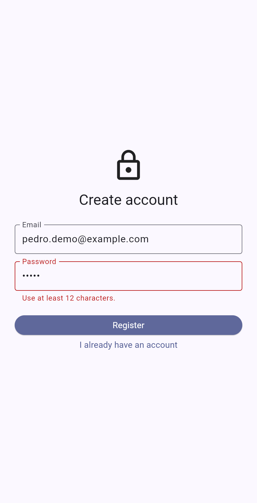<br>Validación en el cliente (mín. 12 caracteres) | 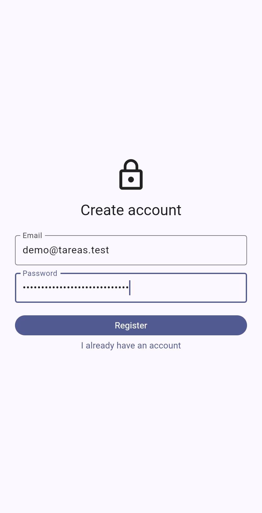<br>Registro |
| <br>Estado vacío | 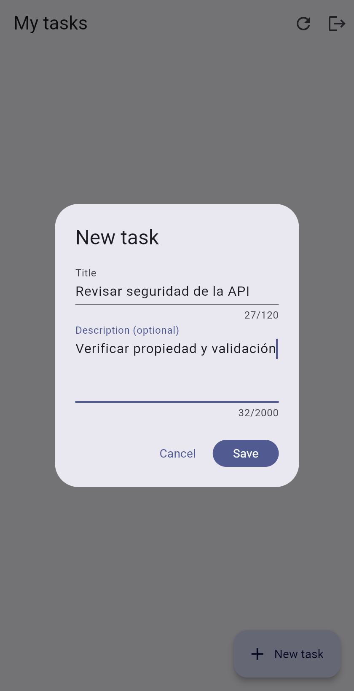<br>Crear tarea | 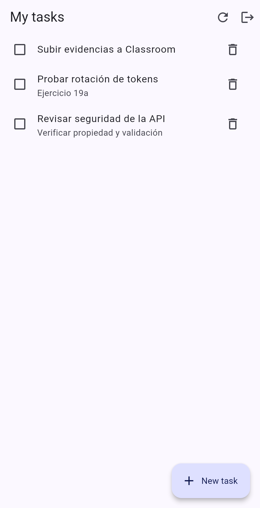<br>Lista de tareas |
| 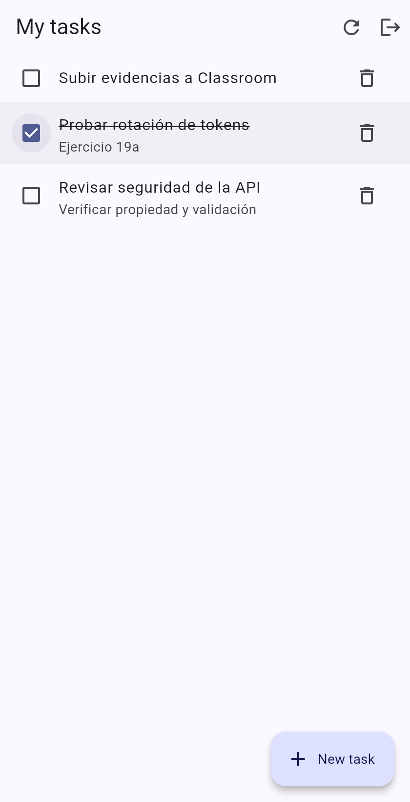<br>Marcar como completada | 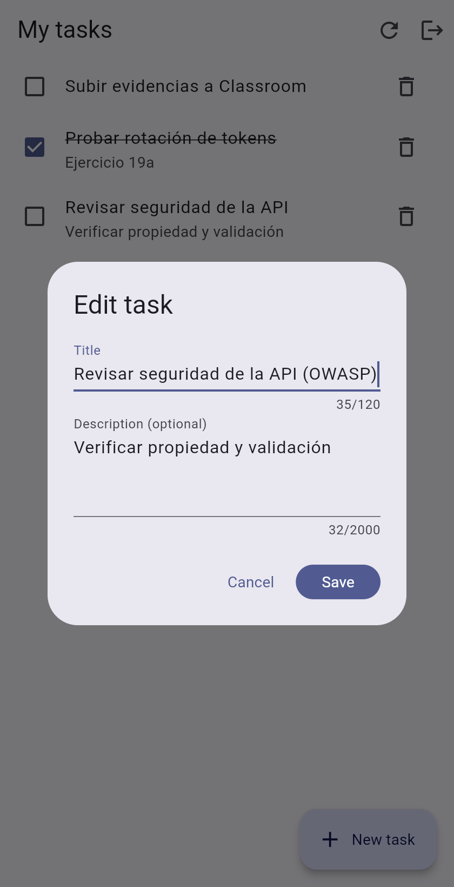<br>Editar tarea | 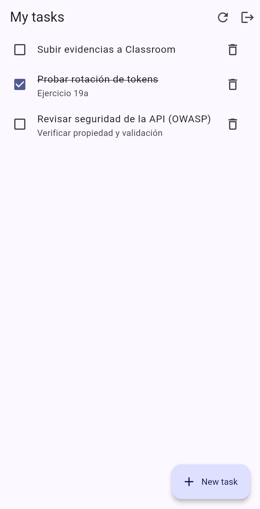<br>Tarea editada |
| 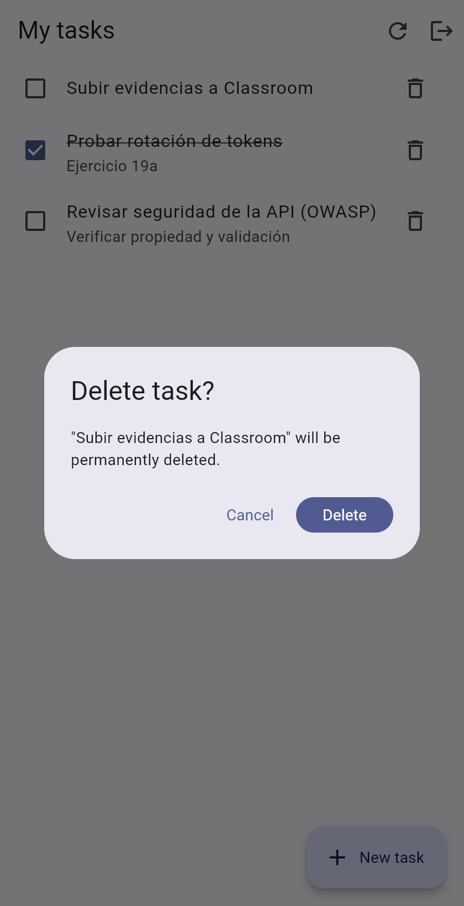<br>Confirmación antes de borrar | 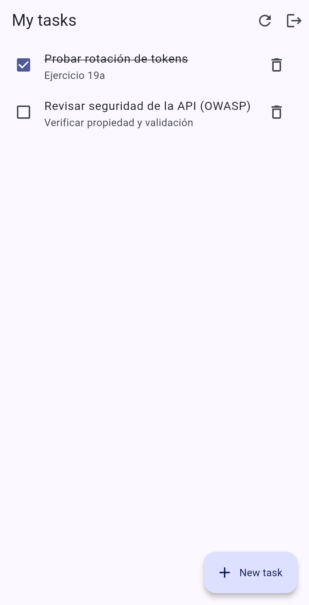<br>Tarea borrada | 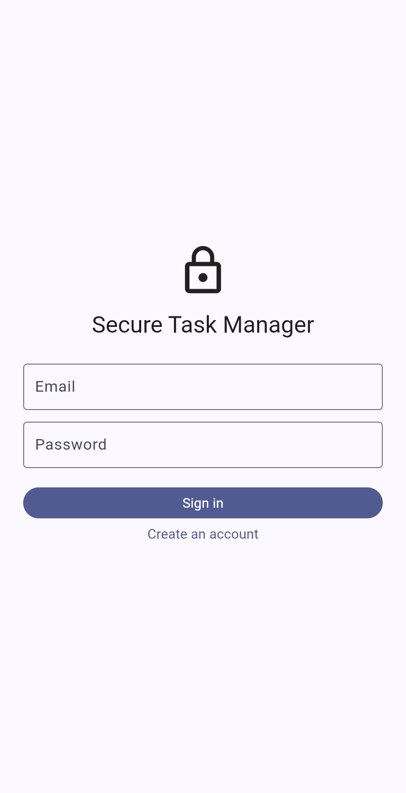<br>Logout regresa al login |
| 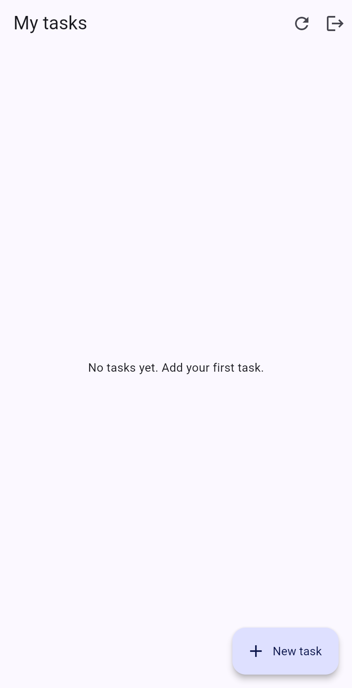<br>Otro usuario no ve las tareas del primero | 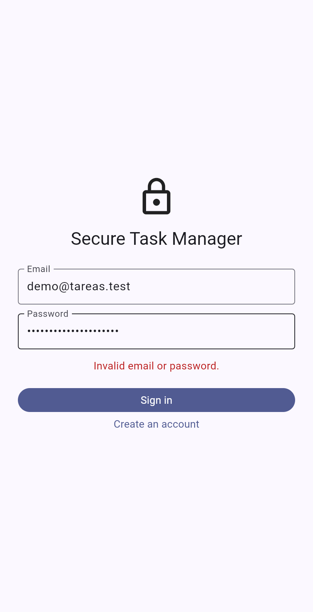<br>Mensaje genérico con contraseña incorrecta | |

### Resultados del ejercicio 19a

| Prueba | Esperado | Resultado | ¿Pasa? |
|---|---|---|---|
| Refresh con token válido | 200 | 200 | ✅ |
| Refresh con token viejo | 401 | 401 | ✅ |
| Refresh con el token más nuevo tras la reutilización | 401 | 401 | ✅ |
| Refresh después de logout | 401 | 401 | ✅ |
| Refresh después de logout-all | 401 | 401 | ✅ |

## Checklist de seguridad

| Práctica | Implementación |
|---|---|
| Autorización a nivel de objeto (IDOR) | Todas las consultas filtran por `id` **y** `ownerId` del token; prueba "user A cannot read, update or delete user B task" |
| Tokens de acceso cortos + rotación | JWT HS256 de 10 min con `iss`/`aud`/`type`; refresh opaco de 48 bytes, rotado en cada uso, 7 días |
| Detección de reutilización | Reusar un token rotado revoca toda la familia (también cubre dos refresh concurrentes) |
| Hash de contraseñas | bcrypt costo 12; hash señuelo para que el login no revele si el email existe |
| Validación y límites | Zod en body, query y params (incluye formato del ID); `ownerId` del cliente se rechaza; body máx. 20 kb |
| Rate limiting | 10 req/15 min en login y registro, 30 en refresh y logout |
| Errores seguros | Manejador central: sin stack, SQL ni mensajes internos; JSON malformado → 400 genérico |
| CORS | Lista blanca explícita; orígenes no permitidos → 403 |
| Secretos y logs | `.env` ignorado por git; pino redacta `authorization`, `password`, `refreshToken` |
| Cliente Flutter | Tokens en `flutter_secure_storage`; refresh single-flight; un solo reintento; logout siempre limpia el almacenamiento; HTTP en claro solo hacia `10.0.2.2` en builds debug |

## Ajustes respecto al PDF

- **Express 5**: `req.query` es de solo lectura, así que el middleware de validación usa `Object.defineProperty`.
- `auth.service.js` del PDF importa `refreshtoken.repository` (sin guion); el archivo real es `refresh-token.repository.js`.
- El `DUMMY_PASSWORD_HASH` del PDF no es un hash bcrypt válido; se genera uno al arrancar.
- Se agregó la capa `controllers/` que aparece en la estructura del PDF, la validación del `taskId` que el PDF pide "antes de desplegar", `GET /tasks/:taskId`, y la edición completa de tareas (reto de extensión).
- PostgreSQL se publica en el puerto **5433** porque había un PostgreSQL nativo usando el 5432.
- `jq` no estaba instalado; `scripts/token-flow.sh` usa Node para leer el JSON.

## Respuestas de "Reflect and discuss"

1. **¿Por qué rotar los refresh tokens?** Cada token sirve una sola vez; si alguien roba uno, su ventana de uso es corta y, si lo usa, se detecta.
2. **¿Qué pasaría si el servidor guardara los refresh tokens en claro?** Una fuga de la base de datos daría sesiones válidas de todos los usuarios. Con SHA-256 solo se filtran hashes inútiles para autenticarse.
3. **¿Por qué la reutilización revoca toda la familia?** El servidor no puede saber si quien reusa es el cliente legítimo o el atacante; revocar toda la cadena corta el acceso del atacante aunque ya tenga el token más nuevo.
4. **¿Qué se pierde si un cliente legítimo reintenta un refresh tras un timeout?** Si la primera petición sí llegó, el reintento con el token viejo cuenta como reutilización y cierra la sesión del usuario. Es el costo de priorizar la seguridad; por eso el cliente hace refresh single-flight y nunca reintenta el refresh.
